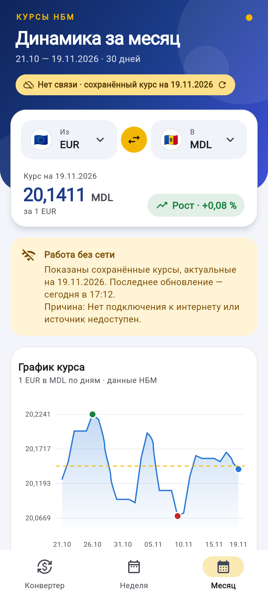

# Курсы НБМ — мобильный конвертер валют с аналитикой

Лабораторная работа №4. Android-приложение на **Flutter (Dart)**: конвертер по
официальным курсам Национального банка Молдовы и экраны динамики курса за
неделю и за месяц. Работает без сети на сохранённых данных.

| Конвертер | Неделя | Месяц |
|---|---|---|
|  |  |  |

| Без сети (кэш) | Первый запуск без сети | Тёмная тема | Выбор валюты |
|---|---|---|---|
|  |  |  |  |

## Возможности

- **Конвертер.** Перевод между MDL и 40 валютами НБМ, включая кросс-курсы
  (например, EUR → USD через MDL). Показаны прямой и обратный курс, дата
  публикации, проверка суммы с понятными сообщениями, поиск валюты.
- **Сравнение за 7 и 30 дней.** График, минимум и максимум с датами, среднее,
  изменение в MDL (или другой валюте котировки) и в процентах, явная
  тенденция: «Рост», «Падение» или «Без изменений».
- **Офлайн.** Курсы сохраняются локально и переживают перезапуск. Без сети
  приложение показывает сохранённые данные, их дату и время последнего
  обновления. Если данных ещё нет совсем, выводится экран ошибки с кнопкой
  «Повторить», и приложение не падает.
- **Обработка ошибок.** Нет сети, тайм-аут, HTTP-ошибка, пустой ответ,
  повреждённый XML и некорректные значения обрабатываются отдельно, и для
  каждого случая есть своё сообщение.
- Светлая и тёмная темы. Выбранная валютная пара запоминается между запусками.

## Требования

- Flutter 3.47+ (Dart 3.13+), проверено на Flutter 3.47.3
- Android SDK и устройство или эмулятор Android

## Запуск

```bash
flutter pub get
flutter run            # на подключённом Android-устройстве или эмуляторе
```

Сборка APK: `flutter build apk --release`. Файл появится в
`build/app/outputs/flutter-apk/`.

## Тесты

Все тесты запускаются одной командой:

```bash
flutter test
```

79 тестов, без обращений к реальному НБМ (используются фикстура и `MockClient`):

| Файл | Что проверяется |
|---|---|
| `test/data/bnm_xml_parser_test.dart` | разбор ответа НБМ (реальная фикстура), номинал, пустая публикация, повреждённые данные |
| `test/data/bnm_client_test.dart` | HTTP 404/500, пустое тело, кодировка, нет сети, тайм-аут |
| `test/data/rate_cache_test.dart` | сохранение между перезапусками, повреждённый кэш, очистка старых записей |
| `test/data/rate_repository_test.dart` | онлайн/офлайн, кэш, частично некорректные данные, отсутствие данных |
| `test/domain/statistics_test.dart` | минимум, максимум, среднее, абсолютное и процентное изменение, тенденция, пустой набор |
| `test/domain/input_validation_test.dart` | валидация суммы и валютной пары |
| `test/ui/app_test.dart` | конвертация, ошибка ввода, офлайн-плашка, экран ошибки, вкладки |

Статический анализ: `flutter analyze`. CI в GitHub Actions
(`.github/workflows/flutter.yml`) запускает анализ и тесты на каждый push и
pull request.

## Архитектура

```
lib/
├── domain/                  # чистый Dart, без Flutter
│   ├── models.dart          # CurrencyRate, DailyRates, RatePoint, кросс-курс
│   ├── statistics.dart      # PeriodStats, тенденция, ряд валютной пары
│   └── input_validation.dart
├── data/
│   ├── bnm_xml_parser.dart  # строгий разбор XML НБМ
│   ├── bnm_client.dart      # HTTP-клиент, классификация ошибок
│   ├── rate_cache.dart      # кэш на SharedPreferences
│   └── rate_repository.dart # источник + кэш, история за N дней
└── ui/
    ├── rates_controller.dart   # состояние (ChangeNotifier)
    ├── home_shell.dart         # вкладки, загрузка/ошибка
    ├── converter_screen.dart
    ├── comparison_screen.dart  # экраны 7 и 30 дней
    ├── theme.dart, format.dart, currency_meta.dart
    └── widgets/                # шапка, график, бейджи, выбор валюты
```

## Источник данных

`https://www.bnm.md/ru/official_exchange_rates?get_xml=1&date=ДД.ММ.ГГГГ`
— один запрос на одну дату. Курсы прошедших дат не меняются, поэтому каждый
день загружается один раз и дальше берётся из кэша. При каждом запуске
повторно запрашивается только сегодняшний день. Подробности и ограничения
описаны в [REPORT.md](REPORT.md#3-источник-исторических-данных-и-его-ограничения).

## Проверка в браузере (только для разработки)

Целевая платформа — Android. Веб-сборка нужна только для быстрой проверки
интерфейса. НБМ не отдаёт CORS-заголовки, поэтому браузер блокирует запросы,
и Chrome нужно запускать с отключённой веб-безопасностью:

```bash
flutter run -d chrome --web-browser-flag "--disable-web-security"
```

На Android этого ограничения нет.

## Git

На каждый этап отдельная ветка, в `main` изменения попадают только через Pull Request:

1. `feature/01-scaffold` — каркас проекта, зависимости, CI
2. `feature/02-data-layer` — модели, парсер, HTTP-клиент, кэш, репозиторий
3. `feature/03-statistics` — статистика периода и валидация ввода
4. `feature/04-converter-ui` — тема, общие виджеты, экран конвертера
5. `feature/05-comparison-screens` — экраны недели и месяца, виджет-тесты
6. `docs/report` — README, REPORT.md, скриншоты
