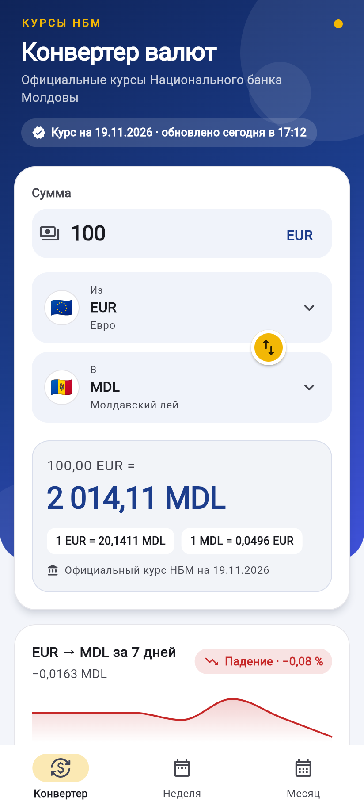
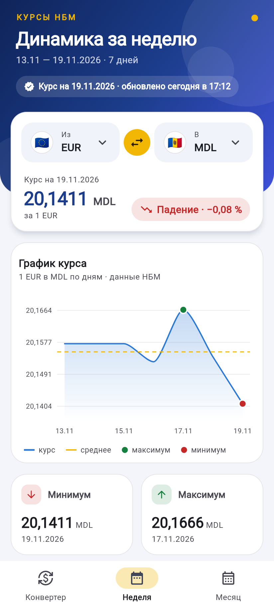
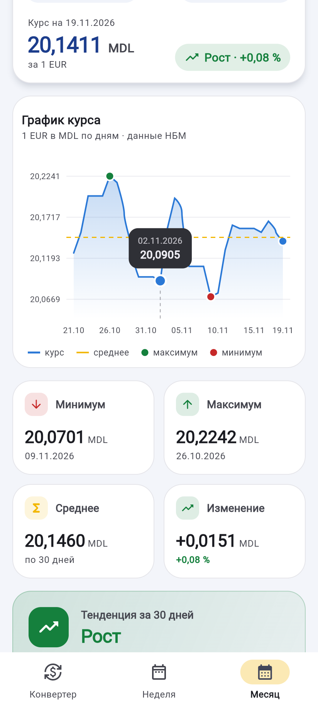
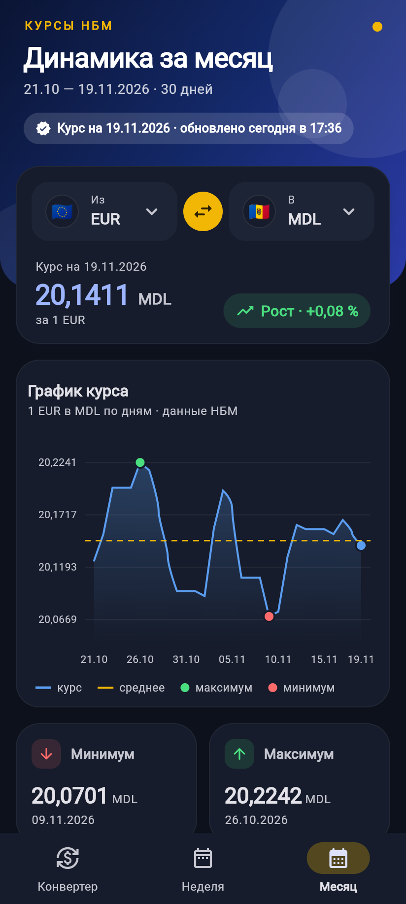
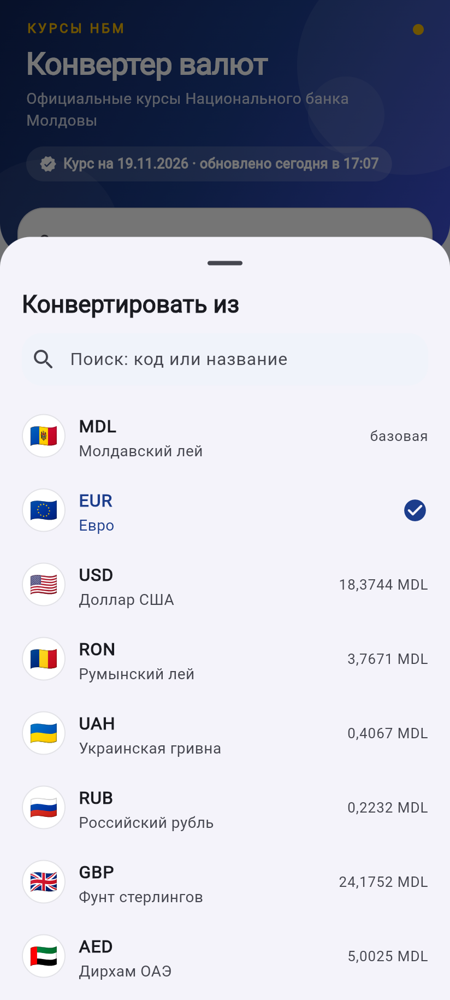
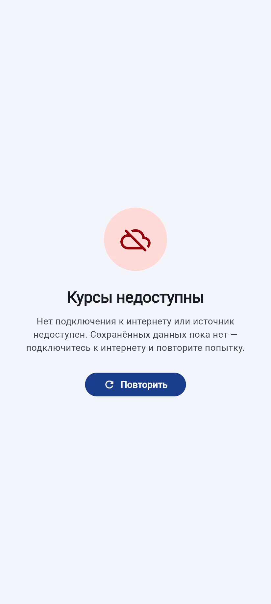
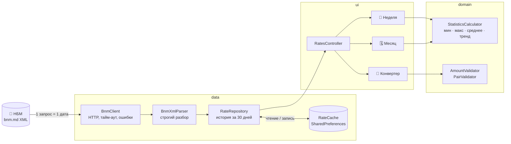
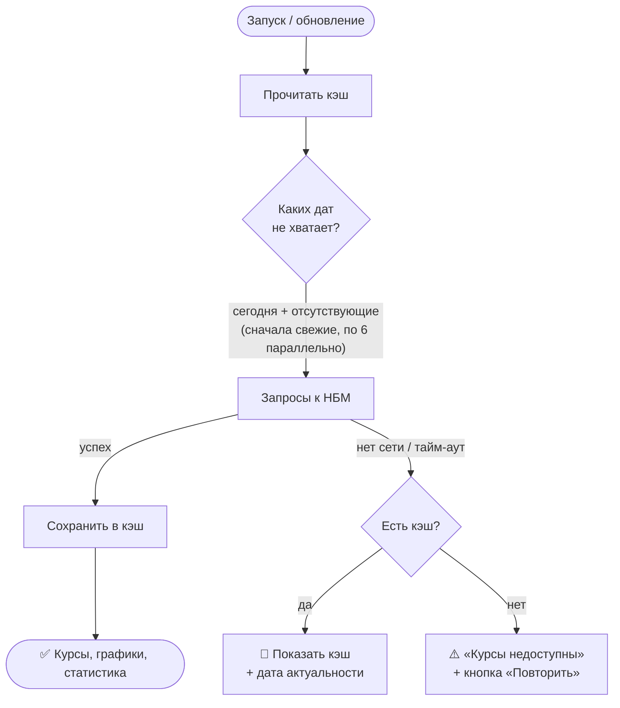

<div align="center">


<br>
<br>

# 💱 Курсы НБМ

**Мобильный конвертер валют по официальным курсам Национального банка Молдовы<br>с аналитикой за неделю и месяц, работает и без интернета**

<br>

[](https://flutter.dev)
[](https://dart.dev)
[](#-запуск)
[](https://m3.material.io)

[](#-тесты)
[](#-тесты)
[](https://www.bnm.md)
[](#-офлайн-режим-как-проверить)

<br>

[Возможности](#-возможности) •
[Экраны](#-экраны) •
[Запуск](#-запуск) •
[Тесты](#-тесты) •
[Архитектура](#-архитектура) •
[Отчёт](REPORT.md)

</div>

<br>

## ✨ Возможности

<table>
<tr>
<td width="50%" valign="top">

### 💱 Конвертер
- **41 валюта**: MDL и 40 валют НБМ
- **Кросс-курсы** любой пары через MDL (EUR → USD, RON → UAH…)
- Прямой и обратный курс, дата публикации
- Поиск валюты по коду и названию, флаги стран
- Проверка ввода: `1 000,50`, `99.5`, понятные ошибки
- Курсы популярных валют с изменением за день

</td>
<td width="50%" valign="top">

### 📈 Аналитика за 7 и 30 дней
- **График** с подсказкой при касании
- **Минимум и максимум** с датами
- **Среднее** за период (пунктир на графике)
- **Изменение** в единицах и в процентах
- **Тенденция**: 📈 Рост · 📉 Падение · ➡️ Без изменений
- Предложение-вывод: *«EUR подешевел относительно MDL…»*

</td>
</tr>
<tr>
<td width="50%" valign="top">

### 📴 Офлайн-режим
- Курсы сохраняются и **переживают перезапуск**
- Без сети: жёлтая плашка с **датой актуальности** данных
- Время последнего успешного обновления
- Первый запуск без сети: экран с кнопкой «Повторить», **без падения**

</td>
<td width="50%" valign="top">

### 🎨 Интерфейс
- Сапфировая гамма с золотыми акцентами, **Material 3**
- **Светлая и тёмная** темы (по системной настройке)
- Аккуратные русские названия валют и форматы `2 014,11`
- Выбранная пара запоминается между запусками
- Подстраивается под крупный системный шрифт

</td>
</tr>
</table>

## 📱 Экраны

<div align="center">

<table>
<tr>
<td align="center"><br><sub><b>Конвертер</b></sub></td>
<td align="center"><br><sub><b>Динамика за неделю</b></sub></td>
<td align="center"><br><sub><b>Динамика за месяц</b></sub></td>
</tr>
<tr>
<td align="center"><br><sub><b>Без сети: данные из кэша</b></sub></td>
<td align="center"><br><sub><b>Тёмная тема</b></sub></td>
<td align="center"><br><sub><b>Выбор валюты с поиском</b></sub></td>
</tr>
</table>

<details>
<summary><b>Ещё экраны</b></summary>
<br>
<table>
<tr>
<td align="center"><br><sub><b>Конвертер в тёмной теме</b></sub></td>
<td align="center"><br><sub><b>Первый запуск без сети</b></sub></td>
</tr>
</table>
</details>

</div>

## 🚀 Запуск

> **Нужно:** Flutter 3.47+ (Dart 3.13+) и Android-устройство или эмулятор.
> Проверить окружение: `flutter doctor`.

```bash
cd lab4
flutter pub get
flutter run
```

<details>
<summary><b>📲 На своём телефоне</b></summary>
<br>

1. **Настройки → О телефоне** → 7 раз нажать на «Номер сборки».
2. **Для разработчиков** → включить «Отладка по USB».
3. Подключить телефон кабелем и разрешить отладку.
4. `flutter devices` должен показать телефон, затем `flutter run`.

</details>

<details>
<summary><b>🖥️ На эмуляторе</b></summary>
<br>

```bash
flutter emulators                    # список эмуляторов
flutter emulators --launch Pixel_8
flutter run
```

</details>

<details>
<summary><b>🌐 В браузере (только для разработки)</b></summary>
<br>

НБМ не отдаёт CORS-заголовки, поэтому браузер блокирует запросы. Для быстрой
проверки интерфейса Chrome запускается с отключённой веб-безопасностью:

```bash
flutter run -d chrome --web-browser-flag "--disable-web-security"
```

На Android этого ограничения нет.

</details>

<details>
<summary><b>📦 Сборка APK</b></summary>
<br>

```bash
flutter build apk --release
# → build/app/outputs/flutter-apk/app-release.apk
```

</details>

**Горячие клавиши во время `flutter run`:** <kbd>r</kbd> — применить изменения,
<kbd>R</kbd> — перезапустить, <kbd>q</kbd> — выйти.

## 🧪 Тесты

Все тесты запускаются **одной командой**:

```bash
flutter test
```

```text
00:03 +79: All tests passed!
```

Тесты не обращаются к реальному НБМ: используются фикстура настоящего ответа и `MockClient`.

| | Файл | Что проверяется | Тестов |
|:-:|---|---|:-:|
| 📄 | [`bnm_xml_parser_test`](test/data/bnm_xml_parser_test.dart) | разбор ответа НБМ, номинал, пустая публикация, битый XML, `NaN`, дубликаты | 19 |
| 🌐 | [`bnm_client_test`](test/data/bnm_client_test.dart) | HTTP 404 / 500, пустое тело, кодировка, нет сети, тайм-аут | 12 |
| 💾 | [`rate_cache_test`](test/data/rate_cache_test.dart) | сохранение между перезапусками, повреждённый кэш, очистка | 3 |
| 🔄 | [`rate_repository_test`](test/data/rate_repository_test.dart) | онлайн / офлайн, кэш, частично плохие данные, нет данных | 8 |
| 📊 | [`statistics_test`](test/domain/statistics_test.dart) | мин, макс, среднее, изменение, %, тенденция, **пустой набор** | 11 |
| ✍️ | [`input_validation_test`](test/domain/input_validation_test.dart) | валидация суммы и валютной пары | 21 |
| 📱 | [`app_test`](test/ui/app_test.dart) | конвертация, ошибка ввода, офлайн-плашка, экран ошибки, вкладки | 5 |

Дополнительно: `flutter analyze` (0 замечаний). [CI](.github/workflows/flutter.yml)
запускает анализ и тесты на каждый push и pull request.

## 🏗️ Архитектура



<details>
<summary><b>📂 Структура проекта</b></summary>
<br>

```
lib/
├── main.dart                  # точка входа, сборка зависимостей
├── app.dart                   # MaterialApp, темы, русская локаль
├── domain/                    # чистый Dart, без Flutter
│   ├── models.dart            # CurrencyRate, DailyRates, RatePoint, кросс-курс
│   ├── statistics.dart        # PeriodStats, Trend, ряд валютной пары
│   └── input_validation.dart  # сумма и валютная пара
├── data/
│   ├── bnm_xml_parser.dart    # разбор XML НБМ
│   ├── bnm_client.dart        # HTTP-клиент, классификация ошибок
│   ├── rate_cache.dart        # кэш на SharedPreferences
│   └── rate_repository.dart   # источник + кэш
└── ui/
    ├── rates_controller.dart  # состояние приложения
    ├── home_shell.dart        # вкладки, загрузка, ошибка
    ├── converter_screen.dart  # 💱 конвертер
    ├── comparison_screen.dart # 📅 7 и 🗓️ 30 дней
    ├── theme.dart             # цвета, светлая и тёмная темы
    ├── format.dart            # числа и даты по-русски
    ├── currency_meta.dart     # названия валют и флаги
    └── widgets/               # шапка, график, бейджи, выбор валюты
test/                          # 79 тестов, структура повторяет lib/
```

</details>

## 🔄 Как загружаются данные



- **Источник:** `https://www.bnm.md/ru/official_exchange_rates?get_xml=1&date=ДД.ММ.ГГГГ`
- НБМ публикует курс **на каждый день**, включая выходные, поэтому месячный график
  доступен **сразу после установки**: копить данные месяц не нужно.
- Курсы прошедших дат не меняются, поэтому каждая дата загружается **один раз**.
  При следующих запусках запрашивается только сегодняшний день.
- Тенденция «без изменений» ставится, если |изменение| < 0,01 %: это защита от шума округления кросс-курсов.

Ограничения источника описаны в [REPORT.md → раздел 3](REPORT.md#3-источник-исторических-данных-и-его-ограничения).

## 🛫 Офлайн-режим: как проверить

| Шаг | Действие | Что видно |
|:-:|---|---|
| 1 | Запустить с интернетом | Курсы загружаются, плашка «Курс на ДД.ММ.ГГГГ · обновлено сегодня в ЧЧ:ММ» |
| 2 | Включить ✈️ **режим полёта**, перезапустить | Курсы на месте, жёлтая плашка **«Нет связи · сохранённый курс на ДД.ММ.ГГГГ»** |
| 3 | Открыть «Неделя» и «Месяц» | Графики и статистика из кэша, карточка «Работа без сети» |
| 4 | Очистить данные приложения, запустить офлайн | Экран **«Курсы недоступны»** с кнопкой «Повторить», приложение не падает |

## 🌿 Git-процесс

Отдельная ветка на каждый этап, слияние в `main` только через Pull Request:


| Ветка | Содержание |
|---|---|
| `feature/01-scaffold` | Каркас Flutter, зависимости, CI |
| `feature/02-data-layer` | Модели, парсер, HTTP-клиент, кэш, репозиторий + тесты |
| `feature/03-statistics` | Статистика периода, тенденция, валидация + тесты |
| `feature/04-converter-ui` | Тема, общие виджеты, экран конвертера |
| `feature/05-comparison-screens` | Экраны недели и месяца, виджет-тесты |
| `docs/report` | README, отчёт, скриншоты |

## 🧰 Стек

| | Технология | Зачем |
|:-:|---|---|
|  | **Flutter 3.47** / **Dart 3.13** | приложение, UI |
| 📈 | [`fl_chart`](https://pub.dev/packages/fl_chart) | графики курса |
| 🌐 | [`http`](https://pub.dev/packages/http) | запросы к НБМ |
| 🧾 | [`xml`](https://pub.dev/packages/xml) | разбор ответа |
| 💾 | [`shared_preferences`](https://pub.dev/packages/shared_preferences) | локальный кэш |
| 🔤 | [`intl`](https://pub.dev/packages/intl), `flutter_localizations` | русские форматы чисел, локализация |
| 🤖 | Claude Code · Claude Opus 5.5 | ИИ-агент разработки, подробнее в [отчёте](REPORT.md#4-инструменты) |

<br>

<div align="center">

---

**Лабораторная работа №4** · Мобильное приложение · Dart вместо C# из Лаб 3

📄 [Полный отчёт](REPORT.md) · 🏦 [Источник данных — НБМ](https://www.bnm.md/ru/official_exchange_rates)

</div>
