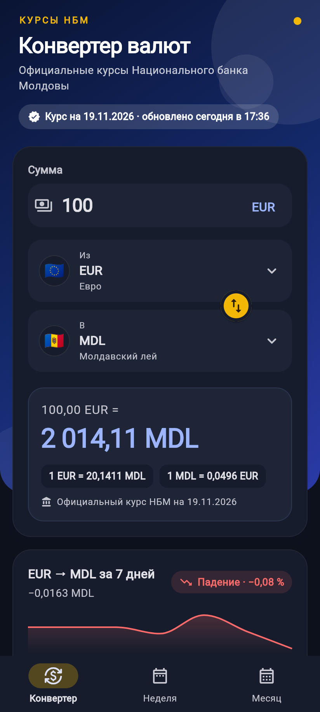
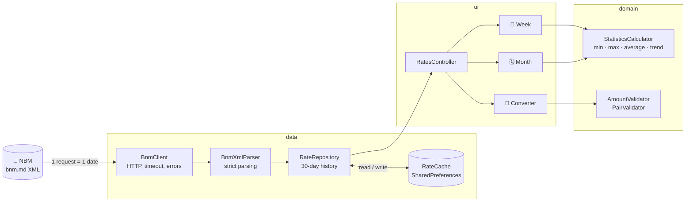
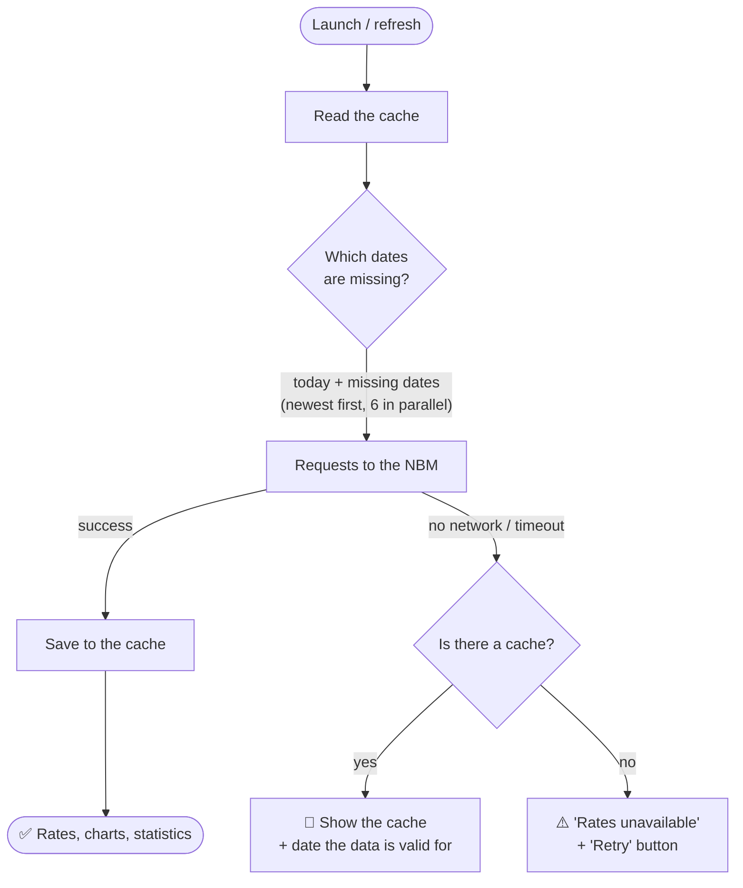
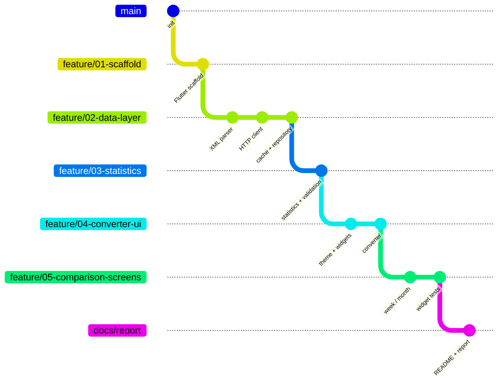

<div align="center">


<br>
<br>

# 💱 NBM Rates

**A mobile currency converter based on the official rates of the National Bank of Moldova,<br>with weekly and monthly analytics, that also works without internet**

<br>

[](https://flutter.dev)
[](https://dart.dev)
[](#-getting-started)
[](https://m3.material.io)

[](#-tests)
[](#-tests)
[](https://www.bnm.md)
[](#-offline-mode-how-to-check)

<br>

[Features](#-features) •
[Screens](#-screens) •
[Getting Started](#-getting-started) •
[Tests](#-tests) •
[Architecture](#️-architecture) •
[Report](REPORT.md)

</div>

<br>

## ✨ Features

<table>
<tr>
<td width="50%" valign="top">

### 💱 Converter
- **41 currencies**: MDL and 40 NBM currencies
- **Cross rates** for any pair through MDL (EUR → USD, RON → UAH…)
- Direct and inverse rate, publication date
- Currency search by code and name, country flags
- Input validation: `1 000,50`, `99.5`, clear error messages
- Rates of popular currencies with the daily change

</td>
<td width="50%" valign="top">

### 📈 Analytics for 7 and 30 days
- **Chart** with a tooltip on touch
- **Minimum and maximum** with dates
- **Average** for the period (dashed line on the chart)
- **Change** in units and in percent
- **Trend**: 📈 Up · 📉 Down · ➡️ No change
- One-sentence conclusion: *"EUR has weakened against MDL…"*

</td>
</tr>
<tr>
<td width="50%" valign="top">

### 📴 Offline mode
- Rates are saved and **survive a restart**
- No network: a yellow badge with the **date the data is valid for**
- Time of the last successful update
- First launch without network: a screen with a "Retry" button, **no crash**

</td>
<td width="50%" valign="top">

### 🎨 Interface
- Sapphire palette with gold accents, **Material 3**
- **Light and dark** themes (follows the system setting)
- Tidy Russian currency names and `2 014,11` number formats
- The selected pair is remembered between launches
- Adapts to a large system font

</td>
</tr>
</table>

## 📱 Screens

<div align="center">

<table>
<tr>
<td align="center"><br><sub><b>Converter</b></sub></td>
<td align="center"><br><sub><b>Weekly dynamics</b></sub></td>
<td align="center"><br><sub><b>Monthly dynamics</b></sub></td>
</tr>
<tr>
<td align="center"><br><sub><b>No network: data from the cache</b></sub></td>
<td align="center"><br><sub><b>Dark theme</b></sub></td>
<td align="center"><br><sub><b>Currency selection with search</b></sub></td>
</tr>
</table>

<details>
<summary><b>More screens</b></summary>
<br>
<table>
<tr>
<td align="center"><br><sub><b>Converter in dark theme</b></sub></td>
<td align="center"><br><sub><b>First launch without network</b></sub></td>
</tr>
</table>
</details>

</div>

## 🚀 Getting Started

> **Required:** Flutter 3.47+ (Dart 3.13+) and an Android device or emulator.
> Check the environment: `flutter doctor`.

```bash
cd lab4
flutter pub get
flutter run
```

<details>
<summary><b>📲 On your own phone</b></summary>
<br>

1. **Settings → About phone** → tap "Build number" 7 times.
2. **Developer options** → enable "USB debugging".
3. Connect the phone with a cable and allow debugging.
4. `flutter devices` should show the phone, then run `flutter run`.

</details>

<details>
<summary><b>🖥️ On an emulator</b></summary>
<br>

```bash
flutter emulators                    # list of emulators
flutter emulators --launch Pixel_8
flutter run
```

</details>

<details>
<summary><b>🌐 In a browser (development only)</b></summary>
<br>

The NBM does not send CORS headers, so the browser blocks the requests. For a quick
interface check, Chrome is launched with web security disabled:

```bash
flutter run -d chrome --web-browser-flag "--disable-web-security"
```

Android does not have this limitation.

</details>

<details>
<summary><b>📦 Building the APK</b></summary>
<br>

```bash
flutter build apk --release
# → build/app/outputs/flutter-apk/app-release.apk
```

</details>

**Hotkeys during `flutter run`:** <kbd>r</kbd> — apply changes,
<kbd>R</kbd> — restart, <kbd>q</kbd> — quit.

## 🧪 Tests

All tests are run with **a single command**:

```bash
flutter test
```

```text
00:03 +79: All tests passed!
```

The tests do not contact the real NBM: they use a fixture of a real response and `MockClient`.

| | File | What is checked | Tests |
|:-:|---|---|:-:|
| 📄 | [`bnm_xml_parser_test`](test/data/bnm_xml_parser_test.dart) | parsing the NBM response, nominal, empty publication, broken XML, `NaN`, duplicates | 19 |
| 🌐 | [`bnm_client_test`](test/data/bnm_client_test.dart) | HTTP 404 / 500, empty body, encoding, no network, timeout | 12 |
| 💾 | [`rate_cache_test`](test/data/rate_cache_test.dart) | persistence between restarts, corrupted cache, cleanup | 3 |
| 🔄 | [`rate_repository_test`](test/data/rate_repository_test.dart) | online / offline, cache, partially bad data, no data | 8 |
| 📊 | [`statistics_test`](test/domain/statistics_test.dart) | min, max, average, change, %, trend, **empty set** | 11 |
| ✍️ | [`input_validation_test`](test/domain/input_validation_test.dart) | validation of the amount and the currency pair | 21 |
| 📱 | [`app_test`](test/ui/app_test.dart) | conversion, input error, offline badge, error screen, tabs | 5 |

Additionally: `flutter analyze` (0 issues). [CI](.github/workflows/flutter.yml)
runs the analyzer and the tests on every push and pull request.

## 🏗️ Architecture



<details>
<summary><b>📂 Project structure</b></summary>
<br>

```
lib/
├── main.dart                  # entry point, dependency wiring
├── app.dart                   # MaterialApp, themes, Russian locale
├── domain/                    # pure Dart, no Flutter
│   ├── models.dart            # CurrencyRate, DailyRates, RatePoint, cross rate
│   ├── statistics.dart        # PeriodStats, Trend, currency pair series
│   └── input_validation.dart  # amount and currency pair
├── data/
│   ├── bnm_xml_parser.dart    # NBM XML parsing
│   ├── bnm_client.dart        # HTTP client, error classification
│   ├── rate_cache.dart        # cache on SharedPreferences
│   └── rate_repository.dart   # source + cache
└── ui/
    ├── rates_controller.dart  # application state
    ├── home_shell.dart        # tabs, loading, error
    ├── converter_screen.dart  # 💱 converter
    ├── comparison_screen.dart # 📅 7 and 🗓️ 30 days
    ├── theme.dart             # colors, light and dark themes
    ├── format.dart            # Russian number and date formats
    ├── currency_meta.dart     # currency names and flags
    └── widgets/               # header, chart, badges, currency selection
test/                          # 79 tests, the structure mirrors lib/
```

</details>

## 🔄 How data is loaded



- **Source:** `https://www.bnm.md/ru/official_exchange_rates?get_xml=1&date=DD.MM.YYYY`
- The NBM publishes a rate **for every day**, including weekends, so the monthly chart
  is available **right after installation**: there is no need to accumulate data for a month.
- Rates for past dates do not change, so each date is loaded **once**.
  On subsequent launches only the current day is requested.
- The "no change" trend is set if |change| < 0.01%: this protects against rounding noise in cross rates.

The limitations of the source are described in [REPORT.md → section 3](REPORT.md#3-источник-исторических-данных-и-его-ограничения).

## 🛫 Offline mode: how to check

The app interface is in Russian, so the on-screen text is given in parentheses.

| Step | Action | What you see |
|:-:|---|---|
| 1 | Launch with internet | Rates are loaded, the badge reads "Rate for DD.MM.YYYY · updated today at HH:MM" («Курс на ДД.ММ.ГГГГ · обновлено сегодня в ЧЧ:ММ») |
| 2 | Turn on ✈️ **airplane mode**, restart | Rates are still there, yellow badge **"No connection · saved rate for DD.MM.YYYY"** («Нет связи · сохранённый курс на ДД.ММ.ГГГГ») |
| 3 | Open "Week" («Неделя») and "Month" («Месяц») | Charts and statistics from the cache, the "Working without network" («Работа без сети») card |
| 4 | Clear the app data, launch offline | The **"Rates unavailable"** («Курсы недоступны») screen with a "Retry" («Повторить») button, the app does not crash |

## 🌿 Git workflow

A separate branch for each stage, merging into `main` only through a Pull Request:



| Branch | Contents |
|---|---|
| `feature/01-scaffold` | Flutter scaffold, dependencies, CI |
| `feature/02-data-layer` | Models, parser, HTTP client, cache, repository + tests |
| `feature/03-statistics` | Period statistics, trend, validation + tests |
| `feature/04-converter-ui` | Theme, shared widgets, converter screen |
| `feature/05-comparison-screens` | Week and month screens, widget tests |
| `docs/report` | README, report, screenshots |

## 🧰 Stack

| | Technology | Purpose |
|:-:|---|---|
|  | **Flutter 3.47** / **Dart 3.13** | application, UI |
| 📈 | [`fl_chart`](https://pub.dev/packages/fl_chart) | rate charts |
| 🌐 | [`http`](https://pub.dev/packages/http) | requests to the NBM |
| 🧾 | [`xml`](https://pub.dev/packages/xml) | response parsing |
| 💾 | [`shared_preferences`](https://pub.dev/packages/shared_preferences) | local cache |
| 🔤 | [`intl`](https://pub.dev/packages/intl), `flutter_localizations` | Russian number formats, localization |
| 🤖 | Claude Code · Claude Opus 5.5 | AI development agent, more in the [report](REPORT.md#4-инструменты) |

<br>

<div align="center">

---

**Laboratory work No. 4** · Mobile application · Dart instead of C# from Lab 3

📄 [Full report](REPORT.md) · 🏦 [Data source — NBM](https://www.bnm.md/ru/official_exchange_rates)

</div>
